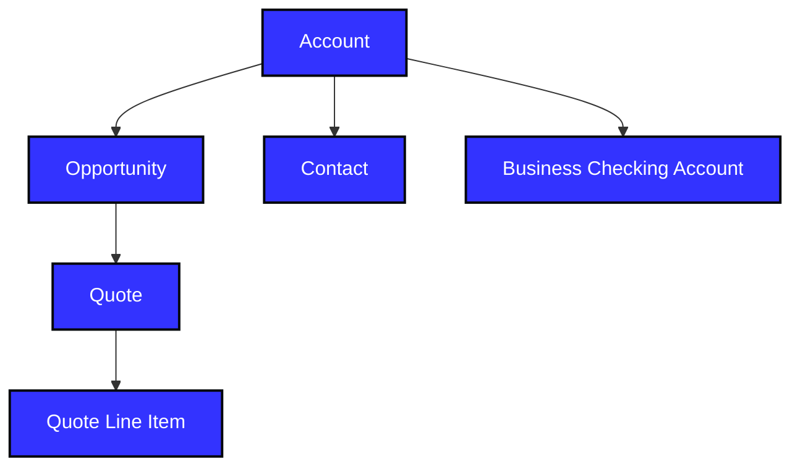

The MerchantE by Omise (ME) Partner to Portal API offers a streamlined process to pass merchant business information related to a sales opportunity, a partial application, or a completed application to MerchantE. This API model is based on the MerchantE application and the business information required to underwrite and onboard merchants with our company.

Clients of this API are granted the ability to create, update, or delete objects containing business information specific to an opportunity, directly from their own customer relationship management system. These objects are then transposed to the Partner Portal in a viewable format, where they will display data needed to onboard the account so that the merchant may begin to process credit card transactions.

The merchant application and onboarding process is available not only through the Partner to Portal API, but also through manual data entry into the custom Partner Portal user interface. Additionally, the Partner Portal can be utilized to append information sent through the API, or as a quality assurance checkpoint prior to submitting the application to underwriting.

The purpose of this document is to provide our partners with an informative reference to be utilized while successfully integrating with the Partner to Portal API offered by MerchantE. This API was designed to automate data entry in the Partner Portal user interface, enabling our partners' businesses to employ an automated approach to managing application and deal submission, and data propagation required for underwriting and onboarding merchants with MerchantE.

## Documentation

MerchantE technical documentation is available at [https://www.merchante.com/developer-portal].

The PCI Security Standards Council manages the rules that merchants must follow when using payment cards. Those rules are available at: [https://www.pcisecuritystandards.org/](https://www.pcisecuritystandards.org/).

The North American Industry Classification System (NAICS) is used by the United States, Canada, and Mexico to classify businesses by industry. Each business is classified into a six-digit NAICS code number based on the majority of activity at the business. The United States Census Bureau NAICS lookup can be found here: [https://www.census.gov/econ/isp/](https://www.census.gov/econ/isp/).

# Getting Started

To get started using the MerchantE Partner to Portal API, you must first contact the MerchantE Partner Support team and request access. Once the use case is discussed and approved, you may receive additional documentation and consultation prior to implementing this tool. The design of the API allows it to be implemented for many use cases. For suggestions on how best to address your business needs, please contact the Partner Support team. When beginning the integration process, it's important to first understand the structure of the data objects. The hierarchy of objects is described below. The fields contained in these objects are described in the Request Field Data tables.

- Account (Parent)

- Opportunity (Child to Account)

- Contact (Child to Account)

- Business Checking Account (Child to Account)

- Quote (Grandchild to Account and Child to Opportunity)

- Quote Line Item (Greatgrandchild to Account and Grandchild to Opportunity)



# Certification

Prior to utilizing the Partner to Portal API in production, a certification process must be completed. A member of the certification team will be assigned to work with each partner as the integration interest is identified. The primary goal of certification is to validate that the Partner API request is accurately formed and successfully transmitted to MerchantE prior to submitting production data for live merchants. The certification endpoint will be shared after approval to utilize the tool. The production endpoint will be shared after completing the certification process.

# Authentication

For a request to be successfully received by MerchantE, it must adhere to the following basic authentication process:

1. ```Get Auth Token``` Request Method is sent via the URL to generate an access token.
    **Note:** Auth token is valid for 24 hours.

2. The access token must be passed as Type: ```OAUTH 2.0``` with the authorization header in the create/update POST requests to the production endpoint.

## Request Parameters

| **Parameter** | **Value** | **Notes** |
| --- | --- | --- |
| grant\_type | password | Literal ```password``` text |
| client\_id | (*To be provided by SE*) | Different for each sandbox/org |
| client\_secret | (*To be provided by SE*) | Different for each sandbox/org |
| username | partnerportalapi@merchante.com.cert | Different for each sandbox/org |
| password | `{{Password+Security_Token}}` | Provided by secure Email, Security Token is not always required depending on the org configuration |

# Merchant Application Fields

The Partner to Portal API can accept both partial and complete applications. Partial applications can be submitted when a limited amount of information about the business is available and will be updated later through the API. Completed applications containing all the required information are needed for underwriting. The merchant application is broken up into the following sections:

- Merchant Information

- Additional Information

- Beneficial Owners

- Transaction Payment Options

- Solutions

- Fees

- Equipment

API requests can be made in JSON or XML format. Attachment submissions must be transmitted to an alternate endpoint.

For the initial request, it's important to use the sample requests, field lists, and validation rules provided. The following specific guidance should be followed when sending a request:

- All required fields are provided.

- At least one Primary Contact/Beneficial Owner is identified.

- Fields required for the Contact/Beneficial Owner is based on the Legal Entity Type/Ownership for the Account.

  - See the Business Entity Type and Ownership Role field definitions for clarification.

  - A Beneficial Owner can have multiple contact roles assigned in a single request.

- Include the Opportunity SFID for Update requests.

  - Source ID can be used to relate SFID to the corresponding fields provided.

- Product Name is required when sending Equipment Information under Quote Line Items.

- To prevent changes to approved merchant applications, updates to applications in the ```Pending Underwriting``` or ```Closed Won``` stages are not allowed.

- The Merchant DBA Name is always required.

- DDA Type is required when submitting checking account information.

- Entity Type, Last Name and Contact Role are required when submitting contact information.

- Product Name is required when submitting equipment information.

The Product Support team will contact the Primary Contact if additional information is required.

For more details, see [**Request Field Data**](#request-field-data-fields).

# Response Field Definitions

These fields are shown in both the *create* and *update* responses.

- SourceId - Indicates whether a specific data object has multiple fields (e.g., QuoteLineItem: Equipment). One field will return ```null```. Two or more fields will return the following values established in the create/update request:

  - For *Contact*, it returns the value of Beneficial\_Owner\_Unique\_Field\_\_c.

  - For *Business Checking Account*, it returns the value of Checking\_Account\_Unique\_Field\_\_c.

  - For *Quote Line Item*, it returns the value of Equipment\_Unique\_Field\_\_c.

- Success - Indicates if the data element was created successfully (e.g., true; false).

- ObjectType - The type of data object being sent and received through the API (e.g., Account, Opportunity, Contact, Business Checking Account, Quote, Quote Line Item).

- Message - A string of text that indicates if a specific data object was created/updated successfully. (e.g., ```Business Checking Account Created Successfully.```).

# Request and Response Examples

Utilizing the list of fields mentioned above, a request can be generated to transmit business data to the Partner Portal. Below are the sample requests and the expected responses to display the correct structure for the API requests. Attachments can be sent through the attachment endpoint utilizing the sample request below.

## Attachment Requirements

- Less than 2 GB in size
- Converted to Base64
- Include the Opportunity ID in the request

## Create Request (JSON)

This is a sample Create request payload to the API:

```json
{
  "Opp": {
    "attributes": {
      "type": "Opportunity"
    },
    "Auto_Submission_to_Underwriting__c": true,
    "StageName": "Pending Underwriting",
    "RecordTypeId": "01234000000M77hAAC",
    "Need_Pricing_Exception_Approval__c": false,
    "Account_Type__c": "Conversion Merchant",
    "Name": "Testing Stage",
    "BET_Table_ID_API_Field__c": "2222",
    "Yearly_Net_Revenue__c": null,
    "Yearly_Card_Volume__c": 100,
    "High_Monthly_Volume__c": 200,
    "Avg_Ticket__c": 300,
    "High_Ticket__c": 400,
    "Visa_MC_Discover_Volume__c": 500,
    "American_Express_Volume__c": 600,
    "Seasonal_Months__c": "Jan;Feb",
    "Customer_Type_B2B_Sales__c": null,
    "Customer_Type_B2C_Sales__c": 100,
    "Refund_Policy__c": "Exchanges Only",
    "Days_to_Ship_Deliver__c": "1 to 7",
    "Advanced_Payments__c": 45,
    "Visa_MasterCard__c": true,
    "Discover_MeS_Settlement__c": true,
    "Discover_Settlement_Existing_Merchant__c": true,
    "American_Express_MeS_Settlement__c": true,
    "Amex_Settlement_Existing_SE__c": "test Amex",
    "Debit_with_Pin__c": true,
    "ACH__c": "true",
    "EBT__c": "true",
    "FCS__c": "test fcs",
    "Check_Authorization__c": "true",
    "Name_of_Provider__c": "test Name of provider",
    "Merchant__c": "test merchant",
    "Check_pct__c": 55,
    "Card_Network_Volume_Internet_CNP__c": 20,
    "Card_Network_Volume_Manually_K_M__c": 20,
    "Card_Network_Volume_MO_TO_CNP__c": 20,
    "Card_Network_Volume_Swiped_CP__c": 40,
    "ACH_Debit_Avg_Dollar_Per_Tx__c": 100,
    "ACH_Credit_Avg_Dollar_Per_Tx__c": 200,
    "ACH_Debit_Max_Dollar_Per_Tx__c": 300,
    "ACH_Credit_Max_Dollar_Per_Tx__c": 400,
    "ACH_Debit_Max_Dollar_Per_Day__c": 500,
    "ACH_Credit_Max_Dollar_Per_Day__c": 600,
    "ACH_Debit_Max_Tx_Per_Day__c": 5,
    "ACH_Credit_Max_Tx_Per_Day__c": 10,
    "ACH_Debit_Max_Dollar_Per_Month__c": 700,
    "ACH_Credit_Max_Dollar_Per_Month__c": 800,
    "ACH_Debit_Max_Tx_Per_Month__c": 15,
    "ACH_Credit_Max_Tx_Per_Month__c": 20
  },
  "Mer": {
    "attributes": {
      "type": "Account"
    },
    "Name": "Test type",
    "Association_ID_API_Field__c": "1111122222",
    "MCC_API_Field__c": "2222",
    "Legal_Name__c": "test legal name 1111",
    "Tax_ID__c": "333333333",
    "State_of_Entity_Formation_Incorporation__c": "CA",
    "Billingstreet": "123 test",
    "BillingCity": "San Jose",
    "Billingstate": "California",
    "Billingpostalcode": "99999",
    "billingcountrycode": "united states",
    "shippingstreet": "333 first st",
    "shippingcity": "san francisco",
    "shippingstate": "California",
    "shippingpostalcode": "88888",
    "shippingcountry": "united states",
    "Physical_Address_Street__c": "444 first st",
    "Physical_Address_City__c": "Palo Alto",
    "Physical_Address_State__c": "CA",
    "Physical_Address_PostalCode__c": "66666",
    "phone": "(444) 555-6666",
    "fax": "777-756-6666",
    "App_Email__c": "test@mes.com",
    "website": "www.mes.com",
    "Customer_Service_Phone__c": "888-888-8888",
    "Ownership": "Government",
    "industry": "Retail",
    "industry_other__c": "test other",
    "Location_Type__c": "Ecommerce",
    "Location_Other__c": "test other",
    "Years_at_Location__c": "3",
    "Date_Established__c": "2000-12-10",
    "Chain_Non_Chain__c": "Single Outlet",
    "Description": "Test description",
    "Ever_accepted_credit_cards_before__c": "true",
    "Name_of_Previous_Processor__c": "test Processor",
    "Ever_had_a_merchant_account_canceled__c": "true",
    "Name_of_Processor_for_canceled_merchant__c": "test processor",
    "Reason_for_cancellation__c": "test test",
    "Date_of_cancellation__c": "2016-10-05",
    "NAICS_Category_Api_Field__c": "21 (Mining)",
    "NAICS_Sub_Category_Api_Field__c": "111110 Soybean Farming"
  },
  "lstBens": [
    {
      "attributes": {
        "type": "Contact"
      },
      "LastName": "test",
      "FirstName": "test",
      "Title": "test",
      "Phone": "1111111111",
      "Percentage_Owned__c": 25,
      "Date_of_Birth__c": "1988-12-05",
      "MailingStreet": "123 Beverly Hills",
      "MailingCity": "Los Angeles",
      "MailingState": "California",
      "MailingPostalCode": "55555",
      "MailingCountry": "United States",
      "SSN__c": "777777777",
      "Contact_Role__c": "Control Owner;Beneficial Owner",
      "Email": "test2@mes2.com",
      "Beneficial_Owner_Unique_Field__c": "111"
    },
    {
      "attributes": {
        "type": "Contact"
      },
      "LastName": "Test Contact2",
      "FirstName": "Test FirstName2",
      "Title": "Test Title2",
      "Phone": "2222222222",
      "Percentage_Owned__c": "",
      "Date_of_Birth__c": "1980-06-25",
      "MailingStreet": "123 second ave",
      "MailingCity": "Los Angeles",
      "MailingState": "California",
      "MailingPostalCode": "55555",
      "MailingCountry": "United States",
      "SSN__c": "666666666",
      "Contact_Role__c": "",
      "Email": "test1@mes1.com",
      "Primary__c": true,
      "Beneficial_Owner_Unique_Field__c": "222"
    }
  ],
  "lstbussCheckAcc": [
    {
      "attributes": {
        "type": "Business_Checking_Account__c"
      },
      "Bank_Name__c": "Wells Fargo",
      "Bank_Street_Address__c": "First street",
      "Bank_City__c": "San Francisco",
      "Bank_State__c": "California",
      "Bank_Zipcode__c": "11111",
      "Checking_Account__c": "1212121212",
      "Transit_Routing__c": "121233333",
      "Years_Open__c": 4,
      "DDA_Type__c": "Chargeback",
      "Checking_Account_Unique_Field__c": "111"
    },
    {
      "attributes": {
        "type": "Business_Checking_Account__c"
      },
      "Bank_Name__c": "Wells Fargo",
      "Bank_Street_Address__c": "First street",
      "Bank_City__c": "San Francisco",
      "Bank_State__c": "California",
      "Bank_Zipcode__c": "11111",
      "Checking_Account__c": "1212121222",
      "Transit_Routing__c": "121212121",
      "Years_Open__c": 4,
      "DDA_Type__c": "fees;Deposit",
      "Checking_Account_Unique_Field__c": "222"
    }
  ],
  "Lstqli": [
    {
      "attributes": {
        "type": "QuoteLineItem"
      },
      "MerchantE_Invoice__c": true,
      "POS_Terminals__c": true,
      "Terminal_Application__c": "Retail",
      "Auto_Batch_Close_HR__c": 20,
      "Auto_Batch_Close_MIN__c": 10,
      "Receipt_Header_Line_4__c": "test11",
      "Receipt_Header_Line_5__c": "test22",
      "Receipt_Footer__c": "test33",
      "Communication_Type__c": "IP",
      "Clerk_Server_Prompt_On__c": "true",
      "Invoice_Prompt_On__c": true,
      "Phone_training_for_merchant__c": "yes",
      "Access_Code_to_dial_out__c": "testtest",
      "AVS_On__c": "true",
      "Tip_Option_On__c": "true",
      "Cash_Back__c": true,
      "Batch_Report_Type__c": "Summary",
      "Equipment_Shipping_Address__c": "Legal Address",
      "Other_Shipping_Address__c": "other",
      "MeS_Virtual_Terminal__c": false,
      "Level_3__c": false,
      "Multi_Merchant__c": false,
      "MeS_Virtual_Terminal_Limited__c": false,
      "Admin_Email_Limited__c": null,
      "MeS_Payment_Gateway__c": false,
      "URL_Address__c": null,
      "Name_of_Certified_Shopping_Cart__c": null,
      "Payment_Gateway_Administrator_Email__c": null,
      "Processsing_Option__c": null,
      "MeS_Pay_by_Phone__c": false,
      "Other_Solution__c": false,
      "Name_of_other_Solution__c": null,
      "Solution_Version__c": null,
      "Name_of_the_digital_certificate_issuer__c": "test3",
      "Digital_certificate_number_s__c": "test4",
      "Digital_certificate_expiration_date_s__c": "test5",
      "Digital_Certificate_Ownership_Status__c": "Shared",
      "V_MC_Acceptance_Options__c": "Both",
      "V_MC_Authorization_Fee__c": 20,
      "V_MC_Diff_Plus_Plan__c": true,
      "V_MC_Diff_Plus_Percentage__c": 2,
      "V_MC_Diff_Plus_Credit_Qualified_Per_Ite__c": 50,
      "V_MC_Diff_Plus_Credit_Qualified_Rate__c": 1.2,
      "V_MC_Diff_Plus_Debit_Qualified_Per_Item__c": 60,
      "V_MC_Diff_Plus_Debit_Qualified_Rate__c": 0.9,
      "V_MC_Pass_Through_Plan__c": false,
      "V_MC_Pass_Through_Per_Item__c": null,
      "V_MC_Pass_Through_Rate__c": null,
      "V_MC_Tiered_Plan__c": false,
      "V_MC_Tiered_Commercial_Qual_Per_Item__c": null,
      "V_MC_Tiered_Commercial_Qual_Rate__c": null,
      "V_MC_Tiered_Credit_Qualified_Per_Item__c": null,
      "V_MC_Tiered_Credit_Qualified_Rate__c": null,
      "V_MC_Tiered_Debit_Qualified_Per_Item__c": null,
      "V_MC_Tiered_Debit_Qualified_Rate__c": null,
      "V_MC_Tiered_Mid_Qual_Per_Item__c": null,
      "V_MC_Tiered_Non_Qual_Per_Item__c": null,
      "V_MC_Tiered_Non_Qual_Rate__c": null,
      "V_MC_Tiered_Rewards_Rate__c": null,
      "V_MC_Tiered_Rewards_Rate_Per_Item__c": null,
      "Amex_Authorization_Fee__c": 35,
      "Amex_Tiered_Plan__c": false,
      "Amex_Tier_3_Per_Item__c": null,
      "Amex_Tier_3_Rate__c": null,
      "Amex_Pass_Through_Plan__c": true,
      "Amex_Pass_Through_Per_Item__c": 36,
      "Amex_Pass_Through_Rate__c": 2.1,
      "Pin_Debit_Authorization_Fee__c": 10,
      "Pin_Debit_Pass_Through_Plan__c": true,
      "Pin_Debit_Pass_Through_Rate__c": 3,
      "Pin_Debit_Pass_Through_Per_Item__c": "",
      "ARU__c": 21,
      "Operator_Asissted__c": 22,
      "AVS__c": 23,
      "Bank_Referral__c": 24,
      "JCB_CUP__c": 25,
      "EBT__c": 26,
      "Other_Authorization_Fee_Other_Fee_Name__c": "PayFlow Pro",
      "Other_Authorization_Fee_Other_Fee_Name2__c": "test",
      "Other_Authorization_Fee_Other_Fee_Amt1__c": 27,
      "Other_Authorization_Fee_Other_Fee_Amt2__c": 28,
      "Account_Application__c": 29,
      "New_Account_Setup__c": 30,
      "One_Time_Account_Updater__c": 31,
      "Wireless_Setup__c": 32,
      "One_Time_Fees_Other_Fee_Name_1__c": "USAePay Setup",
      "One_Time_Fees_Other_Fee_Name_2__c": "test",
      "One_Time_Fees_Other_Fee_Amount_1__c": 33,
      "One_Time_Fees_Other_Fee_Amount_2__c": 34,
      "Minimum_Discount__c": 40,
      "Chargeback_Fee__c": 41,
      "Return_NSF__c": 42,
      "Batch_Fee__c": 43,
      "Internet_Per_Trans__c": 1.5,
      "Per_Occurrence_Account_Updater__c": 44,
      "Yearly_Admin__c": 45,
      "Per_Occurrence_Other_Fee_Name_1__c": "test1",
      "Per_Occurrence_Other_Fee_Name_2__c": "test2",
      "Per_Occurrence_Other_Fee_Amount_1__c": 50,
      "Per_Occurrence_Other_Fee_Amount_2__c": 51,
      "Statement_Fee__c": 100,
      "Electronic_Statement__c": true,
      "Paper_Statement__c": true,
      "PCI_Admin_Monthly__c": 50,
      "PCI_Late_Validation__c": 25,
      "Wireless_Fees__c": 30,
      "Monthly_Fees_Other_Fee_Name_1__c": "USAePay Monthly",
      "Monthly_Fees_Other_Fee_Name_2__c": "PayFlow Pro Monthly",
      "Monthly_Fees_Other_Fee_Name_3__c": "test",
      "Monthly_Fees_Other_Fee_Name_4__c": "test",
      "Monthly_Fees_Other_Fee_Amount_1__c": 10,
      "Monthly_Fees_Other_Fee_Amount_2__c": 20,
      "Monthly_Fees_Other_Fee_Amount_3__c": 30,
      "Monthly_Fees_Other_Fee_Amount_4__c": 40,
      "ACH_Transaction_Fee_Amount__c": 100,
      "ACH_Transaction_Fee__c": 0.9,
      "ACH_Monthly_Service_Fee__c": 60,
      "ACH_Return_Re_presentment_Fee__c": 70,
      "ACH_Unauthorized_Return_State_Fee__c": 80,
      "ACH_SmartPay_Express_Setup_Fee__c": 90,
      "ACH_SmartPay_Express_Monthly_Fee__c": 50,
      "ACH_Hosted_Pay_Monthly_Fee__c": 40,
      "Gross_Settlement_Fee__c": 0.5,
      "ACH_Services__c": true,
      "ACH_Web_API__c": true,
      "ACH_NACHA_File__c": true,
      "ACH_CPP__c": true,
      "ACH_Debit__c": true,
      "ACH_Recurring_Debit__c": true,
      "ACH_Credit__c": true,
      "ACH_Recurring_Credit__c": true,
      "ACH_Refund__c": true,
      "ACH_Web_Check__c": true,
      "ACH_Tel_Check__c": true,
      "ACH_Max_Re_Presentments__c": "0~ None",
      "ACH_First_Re_Presentment__c": "1 (1 day following ACH return)",
      "ACH_Final_Re_Presentment__c": "0~ Final ACH re-presentment will occur after a fixed number of days",
      "ACH_Final_Re_Presentment_Days__c": 2,
      "ACH_RCF_Max_Re_Presentments__c": "1~",
      "ACH_RCF_Amount__c": 20,
      "ACH_RCF_Settlement_Account__c": "1~ Deposit collected fees into Other bank account",
      "ACH_Addtional_Location_Monthly_Fee__c": 5,
      "ACH_Addtional_Bk_Account_Monthly_Fee__c": 6
    },
    {
      "attributes": {
        "type": "QuoteLineItem"
      },
      "Equipment_Rent_Buy_Own__c": "rent",
      "Equipment_Per_Item__c": 200,
      "Equipment_Quantity__c": 2,
      "Equipment_Months__c": 6,
      "Product_Name__c": "Batch Processing",
      "Equipment_Unique_Field__c": "111"
    },
    {
      "attributes": {
        "type": "QuoteLineItem"
      },
      "Equipment_Rent_Buy_Own__c": "buy",
      "Equipment_Per_Item__c": 200,
      "Equipment_Quantity__c": 2,
      "Equipment_Months__c": 6,
      "Product_Name__c": "Chargeback API",
      "Equipment_Unique_Field__c": "222"
    }
  ]
}
```

## Create Response (JSON)

This is the expected response payload from the Create request:

```json
[
  {
    "Success": true,
    "SourceId": null,
    "SFId": "0011800000YkI5NAAV",
    "ObjectType": "Account",
    "Message": "Merchant Information Created Successfully."
  },
  {
    "Success": true,
    "SourceId": "111",
    "SFId": "0031800000SwFDOAA3",
    "ObjectType": "Contact",
    "Message": "Beneficial Owner Created Successfully."
  },
  {
    "Success": true,
    "SourceId": "222",
    "SFId": "0031800000SwFDPAA3",
    "ObjectType": "Contact",
    "Message": "Beneficial Owner Created Successfully."
  },
  {
    "Success": true,
    "SourceId": "111",
    "SFId": "a3h18000000blAWAAY",
    "ObjectType": "Business Checking Account",
    "Message": "Business Checking Account Created Successfully."
  },
  {
    "Success": true,
    "SourceId": "222",
    "SFId": "a3h18000000blAXAAY",
    "ObjectType": "Business Checking Account",
    "Message": "Business Checking Account Created Successfully."
  },
  {
    "Success": true,
    "SourceId": null,
    "SFId": "00618000006PCkHAAW",
    "ObjectType": "Opportunity",
    "Message": "Transaction/Payment Options Created Successfully."
  },
  {
    "Success": true,
    "SourceId": null,
    "SFId": "0Q01800000020nxCAA",
    "ObjectType": "Quote",
    "Message": "Record Created Successfully."
  },
  {
    "Success": true,
    "SourceId": null,
    "SFId": "0QL1800000028mnGAA",
    "ObjectType": "QuoteLineItem",
    "Message": "Solution & Fees Created Successfully."
  },
  {
    "Success": true,
    "SourceId": "111",
    "SFId": "0QL1800000028moGAA",
    "ObjectType": "QuoteLineItem",
    "Message": "Equipment Created Successfully."
  },
  {
    "Success": true,
    "SourceId": "222",
    "SFId": "0QL1800000028mpGAA",
    "ObjectType": "QuoteLineItem",
    "Message": "Equipment Created Successfully."
  }
]
```

**Note:** The ```id``` field below represents the SFId of the ObjectType being updated. The following JSON structure should be utilized for an update request, which includes the object update IDs:

## Update Request (JSON)

This is a sample Update request payload:

```json
{
  "Opp": {
    "attributes": {
      "type": "Opportunity"
    },
    "id": "00618000006PCkHAAW",
    "Merchant_Application_Notes__c": "Test",
    "BET_Table_ID_API_Field__c": "2222",
    "Yearly_Net_Revenue__c": null,
    "Yearly_Card_Volume__c": 100,
    "High_Monthly_Volume__c": 200,
    "Avg_Ticket__c": 300,
    "High_Ticket__c": 400,
    "Visa_MC_Discover_Volume__c": 500,
    "American_Express_Volume__c": 600,
    "Seasonal_Months__c": "Jan;Feb",
    "Customer_Type_B2B_Sales__c": null,
    "Customer_Type_B2C_Sales__c": 100,
    "Refund_Policy__c": "Exchanges Only",
    "Days_to_Ship_Deliver__c": "1 to 7",
    "Advanced_Payments__c": 45,
    "Visa_MasterCard__c": true,
    "Discover_MeS_Settlement__c": true,
    "Discover_Settlement_Existing_Merchant__c": true,
    "American_Express_MeS_Settlement__c": true,
    "Amex_Settlement_Existing_SE__c": "test Amex",
    "Debit_with_Pin__c": true,
    "ACH__c": "true",
    "EBT__c": "true",
    "FCS__c": "test fcs",
    "Check_Authorization__c": "true",
    "Name_of_Provider__c": "test Name of provider",
    "Merchant__c": "test merchant",
    "Check_pct__c": 55,
    "Card_Network_Volume_Internet_CNP__c": 20,
    "Card_Network_Volume_Manually_K_M__c": 20,
    "Card_Network_Volume_MO_TO_CNP__c": 20,
    "Card_Network_Volume_Swiped_CP__c": 40,
    "ACH_Debit_Avg_Dollar_Per_Tx__c": 100,
    "ACH_Credit_Avg_Dollar_Per_Tx__c": 200,
    "ACH_Debit_Max_Dollar_Per_Tx__c": 300,
    "ACH_Credit_Max_Dollar_Per_Tx__c": 400,
    "ACH_Debit_Max_Dollar_Per_Day__c": 500,
    "ACH_Credit_Max_Dollar_Per_Day__c": 600,
    "ACH_Debit_Max_Tx_Per_Day__c": 5,
    "ACH_Credit_Max_Tx_Per_Day__c": 10,
    "ACH_Debit_Max_Dollar_Per_Month__c": 700,
    "ACH_Credit_Max_Dollar_Per_Month__c": 800,
    "ACH_Debit_Max_Tx_Per_Month__c": 15,
    "ACH_Credit_Max_Tx_Per_Month__c": 20
  },
  "Mer": {
    "attributes": {
      "type": "Account"
    },
    "id": "0011800000YkI5NAAV",
    "Name": "Test type",
    "Association_ID_API_Field__c": "1111122222",
    "MCC_API_Field__c": "2222",
    "Legal_Name__c": "test legal name 1111",
    "Tax_ID__c": "333333333",
    "State_of_Entity_Formation_Incorporation__c": "CA",
    "Billingstreet": "123 test",
    "BillingCity": "San Jose",
    "Billingstate": "California",
    "Billingpostalcode": "99999",
    "BillingCountryCode": "united states",
    "shippingstreet": "333 first st",
    "shippingcity": "san francisco",
    "shippingstate": "California",
    "shippingpostalcode": "88888",
    "shippingcountry": "united states",
    "Physical_Address_Street__c": "444 first st",
    "Physical_Address_City__c": "Palo Alto",
    "Physical_Address_State__c": "CA",
    "Physical_Address_PostalCode__c": "66666",
    "phone": "(444) 555-6666",
    "fax": "777-756-6666",
    "App_Email__c": "test@mes.com",
    "website": "www.mes.com",
    "Customer_Service_Phone__c": "888-888-8888",
    "Ownership": "Government",
    "industry": "Retail",
    "industry_other__c": "test other",
    "Location_Type__c": "Ecommerce",
    "Location_Other__c": "test other",
    "Years_at_Location__c": "3",
    "Date_Established__c": "2000-12-10",
    "Chain_Non_Chain__c": "Single Outlet",
    "Description": "Test description",
    "Ever_accepted_credit_cards_before__c": "true",
    "Name_of_Previous_Processor__c": "test Processor",
    "Ever_had_a_merchant_account_canceled__c": "true",
    "Name_of_Processor_for_canceled_merchant__c": "test processor",
    "Reason_for_cancellation__c": "test test",
    "Date_of_cancellation__c": "2016-10-05",
    "NAICS_Category_Api_Field__c": "21 (Mining)",
    "NAICS_Sub_Category_Api_Field__c": "111110 Soybean Farming"
  },
  "lstBens": [
    {
      "attributes": {
        "type": "Contact"
      },
      "id": "0031800000SwFDOAA3",
      "LastName": "test",
      "FirstName": "test",
      "Title": "test",
      "Phone": "1111111111",
      "Percentage_Owned__c": "25",
      "Date_of_Birth__c": "1988-12-05",
      "MailingStreet": "123 Beverly Hills",
      "MailingCity": "Los Angeles",
      "MailingState": "California",
      "MailingPostalCode": "55555",
      "MailingCountry": "United States",
      "SSN__c": "777777777",
      "Contact_Role__c": "Control Owner;Beneficial Owner",
      "Email": "test2@mes2.com",
      "Beneficial_Owner_Unique_Field__c": "111"
    },
    {
      "attributes": {
        "type": "Contact"
      },
      "id": "0031800000SwFDPAA3",
      "LastName": "Test Contact2",
      "FirstName": "Test FirstName2",
      "Title": "Test Title2",
      "Phone": "2222222222",
      "Percentage_Owned__c": "",
      "Date_of_Birth__c": "1980-06-25",
      "MailingStreet": "123 second ave",
      "MailingCity": "Los Angeles",
      "MailingState": "California",
      "MailingPostalCode": "55555",
      "MailingCountry": "United States",
      "SSN__c": "666666666",
      "Contact_Role__c": "",
      "Email": "test1@mes1.com",
      "primary__c": true,
      "Beneficial_Owner_Unique_Field__c": "222"
    }
  ],
  "lstbussCheckAcc": [
    {
      "attributes": {
        "type": "Business_Checking_Account__c"
      },
      "id": "a3h18000000blAWAAY",
      "Bank_Name__c": "Wells Fargo",
      "Bank_Street_Address__c": "First street",
      "Bank_City__c": "San Francisco",
      "Bank_State__c": "California",
      "Bank_Zipcode__c": "11111",
      "Checking_Account__c": "1212121212",
      "Transit_Routing__c": "121233333",
      "Years_Open__c": 4,
      "DDA_Type__c": "Fees;Deposit",
      "Checking_Account_Unique_Field__c": "111"
    },
    {
      "attributes": {
        "type": "Business_Checking_Account__c"
      },
      "id": "a3h18000000blAXAAY",
      "Bank_Name__c": "Wells Fargo",
      "Bank_Street_Address__c": "First street",
      "Bank_City__c": "San Francisco",
      "Bank_State__c": "California",
      "Bank_Zipcode__c": "11111",
      "Checking_Account__c": "1212121222",
      "Transit_Routing__c": "121212121",
      "Years_Open__c": 4,
      "DDA_Type__c": "Chargeback",
      "Checking_Account_Unique_Field__c": "222"
    }
  ],
  "Lstqli": [
    {
      "attributes": {
        "type": "QuoteLineItem"
      },
      "Id": "0QL1800000028mnGAA",
      "MerchantE_Invoice__c": true,
      "POS_Terminals__c": true,
      "Terminal_Application__c": "Retail",
      "Auto_Batch_Close_HR__c": 20,
      "Auto_Batch_Close_MIN__c": 10,
      "Receipt_Header_Line_4__c": "test11",
      "Receipt_Header_Line_5__c": "test22",
      "Receipt_Footer__c": "test33",
      "Communication_Type__c": "IP",
      "Clerk_Server_Prompt_On__c": "true",
      "Invoice_Prompt_On__c": true,
      "Phone_training_for_merchant__c": "yes",
      "Access_Code_to_dial_out__c": "testtest",
      "AVS_On__c": "true",
      "Tip_Option_On__c": "true",
      "Cash_Back__c": true,
      "Batch_Report_Type__c": "Summary",
      "Equipment_Shipping_Address__c": "Legal Address",
      "Other_Shipping_Address__c": "other",
      "MeS_Virtual_Terminal__c": false,
      "Admin_Email__c": null,
      "Level_3__c": false,
      "Multi_Merchant__c": false,
      "MeS_Virtual_Terminal_Limited__c": false,
      "Admin_Email_Limited__c": null,
      "MeS_Payment_Gateway__c": false,
      "URL_Address__c": null,
      "Name_of_Certified_Shopping_Cart__c": null,
      "Payment_Gateway_Administrator_Email__c": null,
      "Processsing_Option__c": null,
      "MeS_Pay_by_Phone__c": false,
      "Other_Solution__c": false,
      "Name_of_other_Solution__c": null,
      "Solution_Version__c": null,
      "Name_of_the_digital_certificate_issuer__c": "test3",
      "Digital_certificate_number_s__c": "test4",
      "Digital_certificate_expiration_date_s__c": "test5",
      "Digital_Certificate_Ownership_Status__c": "Shared",
      "V_MC_Acceptance_Options__c": "Both",
      "V_MC_Authorization_Fee__c": 20,
      "V_MC_Diff_Plus_Plan__c": true,
      "V_MC_Diff_Plus_Percentage__c": 2,
      "V_MC_Diff_Plus_Credit_Qualified_Per_Ite__c": 50,
      "V_MC_Diff_Plus_Credit_Qualified_Rate__c": 1.2,
      "V_MC_Diff_Plus_Debit_Qualified_Per_Item__c": 60,
      "V_MC_Diff_Plus_Debit_Qualified_Rate__c": 0.9,
      "V_MC_Pass_Through_Plan__c": false,
      "V_MC_Pass_Through_Per_Item__c": null,
      "V_MC_Pass_Through_Rate__c": null,
      "V_MC_Tiered_Plan__c": false,
      "V_MC_Tiered_Commercial_Qual_Per_Item__c": null,
      "V_MC_Tiered_Commercial_Qual_Rate__c": null,
      "V_MC_Tiered_Credit_Qualified_Per_Item__c": null,
      "V_MC_Tiered_Credit_Qualified_Rate__c": null,
      "V_MC_Tiered_Debit_Qualified_Per_Item__c": null,
      "V_MC_Tiered_Debit_Qualified_Rate__c": null,
      "V_MC_Tiered_Mid_Qual_Per_Item__c": null,
      "V_MC_Tiered_Mid_Qual_Rate__c": null,
      "V_MC_Tiered_Non_Qual_Per_Item__c": null,
      "V_MC_Tiered_Non_Qual_Rate__c": null,
      "V_MC_Tiered_Rewards_Rate__c": null,
      "V_MC_Tiered_Rewards_Rate_Per_Item__c": null,
      "Amex_Authorization_Fee__c": 35,
      "Amex_Tiered_Plan__c": false,
      "Amex_Tier_3_Per_Item__c": null,
      "Amex_Tier_3_Rate__c": null,
      "Amex_Pass_Through_Plan__c": true,
      "Amex_Pass_Through_Per_Item__c": 36,
      "Amex_Pass_Through_Rate__c": 2.1,
      "Pin_Debit_Authorization_Fee__c": 10,
      "Pin_Debit_Pass_Through_Plan__c": true,
      "Pin_Debit_Pass_Through_Rate__c": 3,
      "Pin_Debit_Pass_Through_Per_Item__c": "",
      "ARU__c": 21,
      "Operator_Asissted__c": 22,
      "AVS__c": 23,
      "Bank_Referral__c": 24,
      "JCB_CUP__c": 25,
      "EBT__c": 26,
      "Other_Authorization_Fee_Other_Fee_Name__c": "PayFlow Pro",
      "Other_Authorization_Fee_Other_Fee_Name2__c": "test",
      "Other_Authorization_Fee_Other_Fee_Amt1__c": 27,
      "Other_Authorization_Fee_Other_Fee_Amt2__c": 28,
      "Account_Application__c": 29,
      "New_Account_Setup__c": 30,
      "One_Time_Account_Updater__c": 31,
      "Wireless_Setup__c": 32,
      "One_Time_Fees_Other_Fee_Name_1__c": "USAePay Setup",
      "One_Time_Fees_Other_Fee_Name_2__c": "test",
      "One_Time_Fees_Other_Fee_Amount_1__c": 33,
      "One_Time_Fees_Other_Fee_Amount_2__c": 34,
      "Minimum_Discount__c": 40,
      "Chargeback_Fee__c": 41,
      "Return_NSF__c": 42,
      "Batch_Fee__c": 43,
      "Internet_Per_Trans__c": 1.5,
      "Per_Occurrence_Account_Updater__c": 44,
      "Yearly_Admin__c": 45,
      "Per_Occurrence_Other_Fee_Name_1__c": "test1",
      "Per_Occurrence_Other_Fee_Name_2__c": "test2",
      "Per_Occurrence_Other_Fee_Amount_1__c": 50,
      "Per_Occurrence_Other_Fee_Amount_2__c": 51,
      "Statement_Fee__c": 100,
      "Electronic_Statement__c": true,
      "Paper_Statement__c": true,
      "PCI_Admin_Monthly__c": 50,
      "PCI_Late_Validation__c": 25,
      "Wireless_Fees__c": 30,
      "Monthly_Fees_Other_Fee_Name_1__c": "USAePay Monthly",
      "Monthly_Fees_Other_Fee_Name_2__c": "PayFlow Pro Monthly",
      "Monthly_Fees_Other_Fee_Name_3__c": "test",
      "Monthly_Fees_Other_Fee_Name_4__c": "test",
      "Monthly_Fees_Other_Fee_Amount_1__c": 10,
      "Monthly_Fees_Other_Fee_Amount_2__c": 20,
      "Monthly_Fees_Other_Fee_Amount_3__c": 30,
      "Monthly_Fees_Other_Fee_Amount_4__c": 40,
      "ACH_Transaction_Fee_Amount__c": 100,
      "ACH_Transaction_Fee__c": 0.9,
      "ACH_Monthly_Service_Fee__c": 60,
      "ACH_Return_Re_presentment_Fee__c": 70,
      "ACH_Unauthorized_Return_State_Fee__c": 80,
      "ACH_SmartPay_Express_Setup_Fee__c": 90,
      "ACH_SmartPay_Express_Monthly_Fee__c": 50,
      "ACH_Hosted_Pay_Monthly_Fee__c": 40,
      "Gross_Settlement_Fee__c": 0.5,
      "ACH_Services__c": true,
      "ACH_Web_API__c": true,
      "ACH_NACHA_File__c": true,
      "ACH_CPP__c": true,
      "ACH_Debit__c": true,
      "ACH_Recurring_Debit__c": true,
      "ACH_Credit__c": true,
      "ACH_Recurring_Credit__c": true,
      "ACH_Refund__c": true,
      "ACH_Web_Check__c": true,
      "ACH_Tel_Check__c": true,
      "ACH_Max_Re_Presentments__c": "0~ None",
      "ACH_First_Re_Presentment__c": "1 (1 day following ACH return)",
      "ACH_Final_Re_Presentment__c": "0~ Final ACH re-presentment will occur after a fixed number of days",
      "ACH_Final_Re_Presentment_Days__c": 2,
      "ACH_RCF_Max_Re_Presentments__c": "1~",
      "ACH_RCF_Amount__c": 20,
      "ACH_RCF_Settlement_Account__c": "1~ Deposit collected fees into Other bank account",
      "ACH_Addtional_Location_Monthly_Fee__c": 5,
      "ACH_Addtional_Bk_Account_Monthly_Fee__c": 6
    },
    {
      "attributes": {
        "type": "QuoteLineItem"
      },
      "id": "0QL1800000028moGAA",
      "Equipment_Rent_Buy_Own__c": "rent",
      "Equipment_Per_Item__c": 200,
      "Equipment_Quantity__c": 2,
      "Equipment_Months__c": 6,
      "Product_Name__c": "Batch Processing",
      "Equipment_Unique_Field__c": "111"
    },
    {
      "attributes": {
        "type": "QuoteLineItem"
      },
      "id": "0QL1800000028mpGAA",
      "Equipment_Rent_Buy_Own__c": "buy",
      "Equipment_Per_Item__c": 200,
      "Equipment_Quantity__c": 2,
      "Equipment_Months__c": 6,
      "Product_Name__c": "Chargeback API",
      "Equipment_Unique_Field__c": "222"
    }
  ]
}
```

## Update Response (JSON)

This is a sample Update response payload:

```json
[
  {
    "Success": true,
    "SourceId": null,
    "SFId": "0011800000YkI5NAAV",
    "ObjectType": "Account",
    "Message": "Merchant Information Updated Successfully."
  },
  {
    "Success": true,
    "SourceId": "111",
    "SFId": "0031800000SwFDOAA3",
    "ObjectType": "Contact",
    "Message": "Beneficial Owner Updated Successfully."
  },
  {
    "Success": true,
    "SourceId": "222",
    "SFId": "0031800000SwFDPAA3",
    "ObjectType": "Contact",
    "Message": "Beneficial Owner Updated Successfully."
  },
  {
    "Success": true,
    "SourceId": "111",
    "SFId": "a3h18000000blAWAAY",
    "ObjectType": "Business Checking Account",
    "Message": "Business Checking Account Updated Successfully."
  },
  {
    "Success": true,
    "SourceId": "222",
    "SFId": "a3h18000000blAXAAY",
    "ObjectType": "Business Checking Account",
    "Message": "Business Checking Account Updated Successfully."
  },
  {
    "Success": true,
    "SourceId": null,
    "SFId": "00618000006PCkHAAW",
    "ObjectType": "Opportunity",
    "Message": "Transaction/Payment Options Updated Successfully."
  },
  {
    "Success": true,
    "SourceId": null,
    "SFId": "0Q01800000020nxCAA",
    "ObjectType": "Quote",
    "Message": "Record Updated Successfully."
  },
  {
    "Success": true,
    "SourceId": null,
    "SFId": "0QL1800000028mnGAA",
    "ObjectType": "QuoteLineItem",
    "Message": "Solution & Fees Updated Successfully."
  },
  {
    "Success": true,
    "SourceId": "111",
    "SFId": "0QL1800000028moGAA",
    "ObjectType": "QuoteLineItem",
    "Message": "Equipment Updated Successfully."
  },
  {
    "Success": true,
    "SourceId": "222",
    "SFId": "0QL1800000028mpGAA",
    "ObjectType": "QuoteLineItem",
    "Message": "Equipment Updated Successfully."
  }
]
```

## Attachment Submission (JSON)

This is a sample request with both a plain text file and an image file converted to Base64.

**Note:** Opportunity ID is a required field for submitting attachments. This request contains both a plain text and an image file converted to Base64.

**Note:** File Attachment Size Limit: 100 MB

```json
{
  "Opportunity": {
    "Id": "006q000000EcfFdAAJ"
  },
  "attachments": [
    {
      "Body": "d29ybGQ=",
      "ContentType": "text/plain",
      "Name": "hello.txt"
    },
    {
      "Body": "**Converted image to Base64 as text** ",
      "ContentType": "image/png",
      "Name": "picture.png"
    }
  ]
}
```

# GET Calls for the Created Records

Utilizing information from the Create Application Response, a request can be made to retrieve information for review. Below are the API endpoints used to retrieve information.

Opportunity\_Id refers to the SFId value associated with the *ObjectType: Opportunity*. Similarly, Quote\_Id refers to the SFId value associated with the *ObjectType: Quote*.

## GET Opportunity

```http
GET /services/data/v54.0/sobjects/Opportunity/{opportunity_id}
```

## GET Account

```http
GET /services/data/v54.0/sobjects/Opportunity/{opportunity_id}/Account
```

## GET Contacts

```http
GET /services/data/v54.0/sobjects/Opportunity/{opportunity_id}/Account/Contacts
```

## GET Business Checking Accounts

```http
GET /services/data/v54.0/sobjects/Opportunity/{opportunity_id}/Account/
Business_Checking_Accounts__r
```

## GET Quotes

```http
GET /services/data/v54.0/sobjects/Opportunity/{opportunity_id}/Quotes
```

## GET Quote Line Items

```http
GET /services/data/v54.0/sobjects/Quote/{quote_id}/QuoteLineItems
```

# Business and Owner Descriptions

Key parts of any merchant application include defining the *business entity type* and the *ownership role* of the beneficial owner(s). The following fields are included on the merchant application and can be transmitted through the Partner to Portal API.

## Business Entity Type

| **Entity or Business Type** | **Information Required On:** | **Data Required** | **Notes** |
| --- | --- | --- | --- |
| Sole Proprietorship (one single owner) | Sole Owner (principal) | Full Name, Physical Address, Social Security Number, DOB | Sole Proprietorships can only have one owner |
| Partnership, Limited Liability Company, Privately Held Corporation | Any Owner with 25% or more ownership interest, and Controlling Authority (one individual only) | Full Name, Physical Address, Social Security Number, DOB, % Ownership, Title | It is possible for an owner to also satisfy the obligation of Controlling Authority in the business. |
| Tax Exempt (e.g. NPO, Political Campaign) | Controlling Authority (one individual only) | Full Name, Physical Address, Social Security Number, DOB, Title | Tax Exempt entity must be granted tax exempt status from the IRS via a 501(c)(2)(3) form |
| Government | Controlling Authority (one individual only) | Full Name, Title | Applies to Federal, State, and Local |
| Publicly Traded Corporation | Controlling Authority (one individual only) | Full Name, Title | A US Public Corporation trades on a US Stock Exchange such as the NASDAQ or NYSE. UW must collect the Company's Ticker Symbol (can be entered on the notes section). |
| Financial Institution | Controlling Authority (one individual only) | Full Name, Title | A Corporation Entity type, whether Public or Private, can also be a Financial Institution. If the Financial Institution is regulated by a Federal or State regulator, only the full name and title is required on the Controlling Authority at the Financial Institution. |

## Ownership Roles

| **Definitions** | **Descriptions** |
| --- | --- |
| Owner (Ownership Prong) | Each individual, if any, who, directly or indirectly, through any contract, arrangement, understanding, relationship or otherwise, owns 25% or more of the equity interest of a merchant. |
| Controlling Authority (Control Prong) | A single individual with significant responsibility for managing the merchant, such as an executive officer or senior manager (e.g., Chief Executive Officer, Chief Financial Officer, Chief Operating Officer, Managing Member, General Partner, President, Vice-President, Treasurer, or any other individual who regularly performs similar functions). |
| Signing Authority | A signing authority can be either an owner or a controlling authority (or both, if applicable). |

# Request Field Data {#request-field-data-fields}

The following fields are included on the merchant application and can be transmitted through the Partner to Portal API.

## Merchant Information

The Merchant Information section of the API collects demographic information about the merchant.

### Merchant Fields

| **Custom UI Field Name** | **Object** | **Data Type** | **Picklist Values** | **Length** | **Required** |
| ------------ | ------------------------- | -------- | ------------------------------------------------ | ------- | ----------- |
| Legal Name | Account | String | | 101 | Yes |
| Federal Tax ID | Account | String | | 17 | Yes |
| State of Formation/Incorporation | Account | String | AK, AL, AR, AZ, CA, CO, CT, DC, DE, FL, GA, HI, IA, ID, IL, IN, KS, KY, LA, MA, MD, ME, MI, MN, MO, MS, MT, NC, ND, NE, NH, NJ, NM, NV, NY, OH, OK, OR, PA, PR, RI, SC, SD, TN, TX, UT, VA, VT, WA, WI, WV, WY | 3 | Yes |
| Legal Street Address | Account | String | | 256 | Yes |
| Legal City | Account | String | | 41 | Yes |
| Legal State | Account | String | See Below | 81 | Yes |
| Legal Zip Code | Account | String | | 21 | Yes |
| Legal Country | Account | String | See Below | 81 | Yes |
| Merchant DBA Name | Account | String | | 256 | Yes |
| Merchant DBA Street | Account | String | | 256 | YesNo |
| Merchant DBA City | Account | String | | 41 | No |
| Merchant DBA State | Account | String | See Below | 81 | No |
| Merchant DBA Zip Code | Account | String | | 21 | No |
| Merchant DBA Country | Accounting | String | See Below | 81 | No |
| Mailing Street | Account | String | | 256 | No |
| Mailing City | Account | String | | 81 | No |
| Mailing State | Account | String | See Below | 81 | No |
| Mailing Zip Code | Account | String | | 81 | No |
| Phone | Account | String | | 11 | Yes |
| Fax | Account | String | | 11 | No |
| Email Address | Account | String | | 101 | Yes |
| Website Address | Account | String | | 256 | No |
| Customer Service Phone | Account | String | | 11 | Yes |
| Legal Entity Type | Account | String | Sole Propietorship, Publically Traded Limited Liability Company, Privately Held Limited Liability Company, Publically Traded Corporation, Privately Held Corporation, Government, Tax Exempt, Publically Traded Partnership, Privately Held Partnership, Financial Institution | 256 | Yes |
| Industry | Account | String | Retail, Restaurant, Lodging, Supermarket, Ecommerce, Direct Marketing Services, Cash Advance, Other | 256 | Yes |
| Industry: Other textbox | Account | String | | 101 | No |
| Business Location | Account | String | Ecommerce, Business Office, Private Residence, Retail Storefront, Bank, Other | 256 | Yes |
| Business Location: Other textbox | Account | String | | 101 | No |
| Years at Location | Account | Integer | | 5 | Yes |
| Date Established | Account | Date | | | Yes |
| Chain/Non-Chain | Account | String | Single Outlet, Chain/Multi-Location, Additional Location | 256 | Yes |
| Description | Account | String | | 32001 | Yes |
| Ever accepted credit cards before? | Account | Boolean | | | No |
| If yes, name of processor? | Account | String | | 101 | No |
| Ever had a merchant account canceled? | Account | Boolean | | | No |
| If yes, name of processor? | Account | String | | 101 | No |
| Reason for Cancellation | Account | String | | 256 | No |
| Date of Cancelation (MMYY): | Account | Date | | 256 | No |
| High Risk Sub-Category | Account | String | None, Business Opportunity, CBD and CBD Based Products, Consumer Lending, Credit Repair, Dating, Discount Membership, Document Prep Services, Firearms/Ammunition, ID Theft/Address Change/Visa and Passport Services, Marketplaces (Non-Travel) - Case by Case, MLM - Case by Case, Money Transfer/MSB, Multi-Level Marketing, Not Applicable, Nutra, Online Gaming/Fantasy Sports, Other, Personal Credit Protection, Telemed/Pharmacies, Vape, Warranties, Web Related Services | 256 | No |
| Sponsorship | Account | Picklist | Wells Fargo, Synovus, Fresno First, KeyBank, Synovus Sabre, Synovus Transcom | | Yes |
| Bank Name | Business Checking Account | String | | 256 | |
| Bank Street Address | Business Checking Account | String | | 256 | Yes |
| Bank City | Business Checking Account | String | | 101 | Yes |
| Bank State | Business Checking Account | String | See Below - US States Only | 101 | Yes |
| Bank Zipcode | Business Checking Account | String | | 21 | Yes |
| Checking Account # | Business Checking Account | Integer | | 101 | Yes |
| Transit Routing # | Business Checking Account | String | | 101 | Yes |
| Years Open | Business Checking Account | Integer | | 19 | Yes |
| NAICS Category | Account | String (Id) | | 51 | No |
| NAICS Sub Category | Account | String (Id) | | 51 | No |
| DDA Type | Business Checking Account | String | None, Deposit, Chargeback, Fees | 4100 | Yes |
| | Business Checking Account | String | | 21 | Yes |
| Contact Phone | Contact | String | | 11 | Yes |
| | Account | Date | | | No |
| | Account | Text | | 13 | No |

### State and Country Codes

### BillingStateCode and ShippingStateCode Picklist Values

| | |
| --- | --- |
| None | Nevada |
| Alabama | New Hampshire |
| Alaska | New Jersey |
| American Samoa | New Mexico |
| Arizona | New York |
| Arkansas | North Carolina |
| Armed Forces Americas | North Dakota |
| Armed Forces Euorpe | Northern Mariana Islands |
| Armed Forces Pacific | Ohio |
| California | Oklahoma |
| Colorado | Oregon |
| Connecticut | Palau |
| Delaware | Pennsylvania |
| District of Columbia | Puerto Rico |
| Federated Micronesia | Rhode Island |
| Florida | South Carolina |
| Georiga | South Dakota |
| Guam | Tennessee |
| Hawaii | Texas |
| Idaho | United States Minor Outlying Islands |
| Illinois | United States Virgin Islands |
| Indiana | Utah |
| Iowa | Vermont |
| Kansas | Virginia |
| Kentucky | Washington |
| Louisiana | West Virginia |
| Maine | Wisconsin |
| Marshall Islands | Wyoming |
| Maryland | |
| Massachusetts | |
| Michigan | |
| Minnesota | |
| Mississippi | |
| Missouri | |
| Montana | |
| Nebraska | |

### BillingCountryCode and ShippingCountryCode

| | | |
| --- | --- | --- |
| None | Gabon | Oman |
| Afghanistan | Gambia | Pakistan |
| Aland Islands | Georgia | Palestinian Territory, Occupied |
| Albania | Germany | Panama |
| Algeria | Ghana | Papau New Guinea |
| Andorra | Gibraltar | Paraguay |
| Angola | Greece | Peru |
| Anguilla | Greenland | Phillipines |
| Antartica | Grenada | Pitcairn |
| Antigua and Barbuda | Guadeloupe | Poland |
| Argentina | Guatemala | Portugal |
| Armenia | Guernsey | Qatar |
| Aruba | Guinea | Reunion |
| Australia | Guinea Bissau | Romania |
| Austria | Guyana | Rwanda |
| Azerbaijan | Haiti | Saint Barthelemy |
| Bahamas | Heard Island and Mcdonald Islands | Saint Helena, Ascension, and Tristan da Cunha |
| Bahrain | Holy See (Vatican City) | Sait Kitts and Nevis |
| Bangladesh | Honduras | Saint Lucia |
| Barbados | Hungary | Saint Martin (French) |
| Belarus | Iceland | Saint Pierre and Miquelon |
| Belguim | India | Saint Vincent and the Grenadines |
| Belize | Indonesia | Samoa |
| Benin | Iran, Islamic Republic of | San Marino |
| Bermuda | Iraq | Sao Tome and Principe |
| Bhutan | Ireland | Saudi Arabia |
| Bolivia, Plurinational State of Bonaire, Sint Eustatius and Saba | Island of Man | Senegal |
| Bosnia and Herzegonvina | Israel | Serbia |
| Botswana | Italy | Seychelles |
| Bouvet Island | Jamaica | Sierra Leone |
| Brazil | Japan | Singapore |
| British Indian Ocean Territory | Jersey | Sint Maarten (Dutch) |
| Bunei Darussalam | Jordan | Slovakia |
| Bulgaria | Kazakhstan | Slovenia |
| Burkina Faso | Kenya | Solomon Islands |
| Burundi | Kiribati | Somalia |
| Cambodia | Korea, People's Democratic Republic of | South Africa |
| Cameroon | Korea, Republic of | South Georgia and the South Sandwich Islands |
| Canada | Kuwait | South Sudan |
| Cape Verde | Kyrgyzstan | Spain |
| Cayman Islands | Lao People's Democratic Republic | Sri Lanka |
| Central African Republic | Latvia | Sudan |
| Chad | Lebanon | Suriname |
| Chile | Lesotho | Svalbard and Jan Mayen |
| China | Liberia | Swaziland |
| Chinese Taipei | Liyan Arab Jamahiriya | Sweden |
| Christmas Island | Liechtenstein | Switzerland |
| Cocos (Keeling) Islands | Lithuania | Syrian Arab Republic |
| Colombia | Luxembourg | Tajikistan |
| Congo | Macao | Tazania, United Republic of |
| Congo, The Democratic Republic of the | Macedonia, The Former Yugoslav Republic of | Thailand |
| Cook Islands | Madagascar | Timor Leste |
| Costa Rica | Malawi | Togo |
| Cote d'Ivoire | Malaysia | Tokelau |
| Croatia | Maldives | Tonga |
| Cuba | Mali | Trinidad and Tobago |
| Curacao | Malta | Tunisia |
| Cyprus | Martinique | Turkey |
| Czech Republic | Mauritania | Turkmenistan |
| Denmark | Mauritius | Turks and Caicos Islands |
| Djibouti | Mayotte | Tuvalu |
| Dominica | Mexico | Uganda |
| Dominican Republic | Moldova, Republic of | Ukraine |
| Ecuador | Monaco | United Arab Emirates |
| Egypt | Mongolia | United Kingdom |
| El Salvador | Montenegro | United States |
| Equatorial Guinea | Montserrat | Uruguay |
| Eritrea | Morocco | Uzbekistan |
| Estonia | Mozambique | Vanuatu |
| Ethiopia | Myanmar | Venezuela, Bolivarian Republic of |
| Falkland Islands (Malvinas) | Nambia | Viet Nam |
| Faroe Islands | Nauru | Virgin Islands, British |
| Fiji | Nepal | Wallis and Futuna |
| Finland | Netherlands | Western Sahara |
| France | New Caledonia | Yemen |
| Frech Guiana | New Zealand | Zambia |
| French Polynesia | Nicaragua | Zimbabwe |
| French Southern Territories | Niger | |
| | Nigeria | |
| | Niue | |
| | Norfold Island | |
| | Norway | |

## Additional Information

Additional Information data is collected in the API to describe the merchant's business.

### Additional Fields

| **Custom UI Field Name** | **Object** | **Data Type** | **Picklist Values** | **Length** | **Required** |
| ------------ | ------------------------- | -------- | ------------------------------------------------ | ------- | ----------- |
| MCC | Account | String (Id) | | 101 | Yes |
| Association ID | Account | String (Id) | | 19 | Yes |
| Partner Branch | Account | String (Id) | | 19 | No |
| Association ID (Manual Entry) | Account | String | | 101 | No |
| Yearly Net Revenue | Opportunity | Decimal | | 19 | Yes |
| Account Type | Opportunity | String | New Merchant, Conversion Merchant, Renewal Merchant, Cloned Merchant Deal | 256 | No |
| Change Notes | Opportunity | String | | 65536 | No |

## Beneficial Owners

Information about the Beneficial Owners for a business is collected in the API.

### Beneficial Owners Fields

| **Custom UI Field Name** | **Object** | **Data Type** | **Picklist Values** | **Length** | **Required** |
| ------------ | ------------------------- | -------- | ------------------------------------------------ | ------- | ----------- |
| Contact First Name | Contact | String | | 41 | Yes |
| Contact Last Name | Contact | String | | 81 | Yes |
| % Ownership | Contact | Double | | 17 | Yes |
| Date of Birth | Contact | Date | | | Yes |
| Street Address | Contact | String | | 256 | Yes |
| City | Contact | String | | 41 | Yes |
| State | Contact | String | | 81 | Yes |
| Zipcode | Contact | String | | 21 | Yes |
| Country | Contact | String | | 11 | No |
| Social Security Number | Contact | String | | 10 | Yes |
| Contact Role | Contact | String | Beneficial Owner, Control Owner, Other | 4100 | Yes |
| Contact Title | Contact | String | | 129 | Yes |
| Email | Contact | String | | 81 | Yes |
| | Contact | Boolean | | | Yes |
| | Contact | Single | | 21 | No |

## Transaction Payment Options

The Transaction Payment Options portion of the API collects information about the merchant's processing history and preferences for processing options with MeS.

### Payment Fields

| **Custom UI Field Name** | **Object** | **Data Type** | **Picklist Values** | **Length** | **Required** |
| ------------ | ------------------------- | -------- | ------------------------------------------------ | ------- | ----------- |
| Yearly Card Volume | Opportunity | Double | | 19 | Yes |
| High Monthly Processing Volumes | Opportunity | Double | | 11 | Yes |
| Average Ticket | Opportunity | Double | | 1 | Yes |
| High Ticket | Opportunity | Double | | 17 | Yes |
| Visa/MC/Discover Volume | Opportuniy | Double | | 17 | Yes |
| American Express Volume | Opportunity | Double | | 17 | No |
| Seasonal Months of Operation | Opportunity | String | Jan, Feb, Mar, Apr, May, Jun, Jul, Aug, Sep, Oct, Nov, Dec | 4100 | No |
| Mail Order/Tel Order | Opportunity | Double | | 17 | Yes |
| Internet | Opportunity | Double | | 17 | Yes |
| Swiped | Opportunity | Double | | 17 | Yes |
| Manually Keyed/Mobile | Opportunity | Double | | 17 | Yes |
| Customer Type (must add up to 100%) | Opportunity | Double | | 17 | Yes |
| Customer Type (must add up to 100%) | Opportunity | Double | | 17 | yes |
| Refund Policy | Opportunity | String | Refund in 30 days or Less, No Refunds or Exchanges, Exchanges Only, Not Applicable, Credit V/MC/Dis Account, Full Refund, Refund Credit, Refund Merchandise | 256 | Yes |
| Days to Ship/Deliver | Opportunity | String | Immediate, 1 to 7, 8 to 14, 15 to 30, Over 30 | 256 | Yes |
| % Advanced Payments | Opportunity | Double | | 3 | No |
| Visa/Master Card | Opportunity | Boolean | | | No |
| Discover MeS Settlement | Opportunity | Boolean | | | No |
| American Express (MeS Settlement) | Opportunity | Boolean | | | No |
| Debit with Pin | Opportunity | Boolean | | | No |
| EBT | Opportunity | Boolean | | | No |
| Discover Settlement/Existing SE # | Opportunity | String | | 256 | No |
| AmEx Settlement/Existing SE # | Opportunity | String | | 256 | No |
| ACH Configuration | Opportunity | Boolean | | | No |
| FCS# | Opportunity | String | | 11 | No |
| Check Authorization | Opportunity | Boolean | | | No |
| Name of Provider | Opportunity | String | | 61 | No |
| Merchant # | Opportunity | String | | 41 | No |
| Check % | Opportunity | Double | | 19 | No |
| Average Dollar Amount per Single Transacton Debit | Opportunity | Double | | 17 | No |
| Average Dollar Amount per Single Transaction Credit | Opportunity | Double | | 17 | No |
| Maximum Number of Transactions per Day Debit | Opportunity | Double | | 17 | No |
| Maximum Number of Transactions per Day Credit | Opportunity | Double | | 17 | No |
| Maximum Dollar Amount per Month Debit | Opportunity | Double | | 17 | No |
| Maximum Dollar Amount per Month Credit | Opportunity | Double | | 17 | No |
| Maximum Number of Transactions per Month Debit | Opportunity | Double | | 19 | No |
| Maximum Number of Transactions per Month Credit | Opportunity | Double | | 19 | No |

## Solutions

The Solutions portion collects information about the merchant's terminal and the many processing options available.

### Solutions Fields

| **Custom UI Field Name** | **Object** | **Data Type** | **Picklist Values** | **Length** | **Required** |
| ------------ | ------------------------- | -------- | ------------------------------------------------ | ------- | ----------- |
| POS Terminal | Quote Line Items | Boolean | | | No |
| MeS Virtual Terminal | Quote Line Items | Boolean | | | No |
| Admin Email | Quote Line Items | String | | | No |
| Level 3 | Quote Line Item | Boolean | | | No |
| Mulit Merchant | Quote Line Item | Boolean | | | No |
| MeS Virtual Terminal Limited | Quote Line Item | Boolean | | | No |
| Administrator Email | Quote Line Items | String | | | No |
| MerhantE Payment Platform | Quote Line Item | Boolean | | | Yes |
| URL Address | Quote Line Item | Boolean | | 256 | Yes |
| Name of Certified Shopping Cart | Quote Line Item | String | | 256 | Yes |
| Administrator Email | Quote Line Item | String | | | Yes |
| Processing Option | Quote Line Items | String | MeS Hosted Payment, MeS Card Present and Card Not Present, MeS e-Commerce | | Yes |
| MeS Tele Pay | Quote Line Items | Boolean | | | No |
| Other Solution | Quote Line Items | Boolean | | | No |
| Name of Other Solution | Quote Line Items | String | | 256 | No |
| Solution Version # | Quote Line Items | String | | 256 | No |
| Name of the digital certificate issuer | Quote Line Items | String | | 256 | No |
| Digital certificate number(s) | Quote Line Items | String | | 256 | No |
| Digital certificate expiration date(s) | Quote Line Items | String | | 256 | No |
| Ownership status of your digital certificate(s) | Quote Line Items | String | Individual, Shared | | No |
| Terminal Application | Quote Line Items | String | Retail, Restaurant, Lodging, Cash Advance | | No |
| Communication Type | Quote Line Items | String | Dial IP, Wireless | | No |
| Access Code # to dial out | Quote Line Items | String | | 256 | No |
| Auto Batch Close | Quote Line Items | Double | | 19 | No |
| Auto Batch Close | Quote Line Items | Double | | 19 | No |
| Receipt Header Line 4 | Quote Line Items | String | | 256 | No |
| Receipt Header Line 5 | Quote Line Items | String | | 256 | No |
| Receipt Footer | Quote Line Items | String | | 256 | No |
| AVS On | Quote Line Items | Boolean | | | No |
| Tip Option On | Quote Line Items | Boolean | | | No |
| Clerk/Server Prompt On | Quote Line Items | Boolean | | | No |
| Phone training for merchant? | Quote List Items | String | Yes, No | | No |
| Equipment Shipping Address | Quote Line Items | String | Merchant Business Address, Legal Address, Other Address | | No |
| Other Shipping Address | Quote Line Items | String | | 256 | No |
| Invoice Prompt On | Quote Line Items | Boolean | | | No |
| Cash Back On | Quote Line Items | Boolean | | | No |
| Batch Report Type | Quote Line Items | String | Summary, Batch Detail | | No |
| ACH Services | Quote Line Items | Boolean | | | No |
| Web Services API | Quote Line Items | Boolean | | | No |
| Fed-Ready/NACHA File Upload | Quote Line Items | Boolean | | | No |
| Customer Payment Portal (CPP) | Quote Line Items | Boolean | | | No |
| ACH Debit | Quote Line Items | Boolean | | | No |
| ACH Recurring Debit | Quote Line Items | Boolean | | | |
| ACH Credit | Quote Line Items | Boolean | | | No |
| ACH Recurring Credit | Quote Line Items | Boolean | | | No |
| ACH Refund | Quote Line Items | Boolean | | | No |
| Web - Internet Check | Quote Line Items | Boolean | | | No |
| TEL - Telephone Check | Quote Line Items | Boolean | | | No |
| ACH Face Amount: Maximum Number of Re-Presentments | Quote Line Items | String | 0~ None, 1~ 1 re-presentment, 2~ re-presentments | | No |
| Timing of First Re-Presentment | Quote Line Items | String | 0 (Immediately following ACH return), 1 (1 day following ACH return), 2 (2 days following ACH return), 3 (3 days following ACH return), 4 (4 days following ACH return), 5 (5 days following ACH return), 6 (6 days following ACH return), 7 (7 days following ACH return), 8 (8 days following ACH return), 9 (9 days following ACH return), 10 (10 days following ACH return), 15 (15 days following ACH return), 20 (20 days following ACH return), 25 (25 days following ACH return), 30 (30 days following ACH return) | | No |
| Timing of Final Re-Presentment | Quote Line Items | String | 0~ Final ACH re-presentment will occur after a fixed number of days, Final ACH re-presentment will coincide with common paydays | | No |
| ACH Face Amount: Final Re-Presentment Days | Quote Line Items | Decimal | | 19 | No |
| ACH Returned Check Fee: Maximum Re-Presentments | Quote Line Items | String | 0~ None, 1~, 2~, 3~ | | No |
| ACH Returned Check Fee Amount | Quote Line Items | Decimal | | 11 | No |
| ACH Returned Check Fee Settlement | Quote Line Items | String | 0~ Deposit collected fees into Customer's settlement bank account, 1~ Deposit collected fees into Other bank account | | No |
| Would Merchant Like Training from MeS Activations? | Quote Line Items | Boolean | | | No |
| Product/POS Training | Quote Line Items | Boolean | | | No |
| PCI Training | Quote Line Items | Boolean | | | No |
| Business Platform Training | Quote Line Items | Boolean | | | No |
| Level 3 Training | Quote Line Items | Boolean | | | No |
| Additional information (optional) | Quote Line Items | String | | 130769 | No |
| Authorization Host | Quote List Items | String | Sierra, Summit, Transit/MultiPass | | No |
| | Quote Line Items | String | Sierra, Summit, Transit/MultiPass | | No |
| Customer Rate (not to exceed 3.5%) | Quote Line Items | Double | | (2,2) | No |
| Surcharge | Quote Line Items | Boolean | | | No |
| Surcharge Fee | Quote Line Items | Boolean | | | No |
| MerchantE Invoice | Quote Line Items | Boolean | | | No |
| MerchantE Invoice Administrator Email | Quote Line Items | String | | | No |
| MerchantE Invoice Link | Quote Line Items | Boolean | | | No |
| MerchantE Invoice Link Administrator Email | Quote Line Items | String | | | No |
| Hosted Payments | Quote Line Items | Boolean | | | No |
| Hosted Payments Administrator Email | Quote Line Items | String | | | No |
| Interchange Optimization | Quote Line Items | Boolean | | | No |
| Interchange Optimization Administrator Email | Quote Line Items | String | | | No |
| Money OUT Services | Quote Line Items | Boolean | | | No |

## Fees

The API collects information about the Fees and rates the merchant will be billed as part of their processing agreement.

### Fee Fields

| **Custom UI Field Name** | **Object** | **Data Type** | **Picklist Values** | **Length** | **Required** |
| ------------ | ------------------------- | -------- | ------------------------------------------------ | ------- | ----------- |
| BET Table | Quote Line Items | String | | 256 | Yes |
| Acceptance Options | Quote Line Items | String | Credit/Business Cards, Debit/Prepaid Cards, Both | | No |
| Visa MasterCard - Authorization Fee | Quote Line Items | Double | | 11 | No |
| V/MC Diff. Plus | Quote Line Items | Boolean | | | No |
| V/MC Diff. Plus Percentage | Quote Line Items | Double | | 3 | No |
| V/MC Diff. Plus Credit Qualified Per Item | Quote Line Items | Double | | 11 | No |
| V/MC Diff. Plus Credit Qualitied Rate | Quote Line Items | Double | | 3 | No |
| V/MC Diff. Plus Debit Qualified Per Item | Quote Line Items | Double | | 11 | No |
| V/MC Diff. Plus Debit Qualified Rate | Quote Line Items | Double | | 3 | No |
| V/MC Tiered | Quote Line Items | Boolean | | | No |
| V/MC Commercial Qualified - $ Per Item | Quote Line Items | Double | | 11 | No |
| V/MC Commercial Qualified - Rate % | Quote Line Items | Double | | 3 | No |
| V/MC Tiered Debit Qualified Per Item | Quote Line Items | Double | | 11 | No |
| V/MC Tiered Debit Qualified Rate | Quote Line Items | Double | | 3 | No |
| V/MC Tiered Mid Qual Per Item | Quote Line Items | Double | | 11 | No |
| V/MC Tiered Mid Qual Rate | Quote Line Items | Double | | 3 | No |
| V/MC Tiered Non Qual Per Item | Quote Line Items | Double | | 11 | No |
| V/MC Tiered Non Qual Rate | Quote Line Items | Double | | 3 | No |
| V/MC Tiered Rewards Rate | Quote Line Items | Double | | 3 | No |
| V/MC Tiered Rewards Rate Per Item | Quote Line Items | Double | | 11 | No |
| V/MC - Pass Through Per Item | Quote Line Items | Double | | 11 | No |
| V/MC - Pass Through | Quote Line Items | Boolean | | | No |
| V/MC - Pass Through Rate | Quote Line Items | Double | | 3 | No |
| Amex - Authorization Fee | Quote Line Items | Double | | 11 | No |
| Amex - Bundled Plan | Quote Line Items | Boolean | | | No |
| Amex Pass Through $ | Quote Line Items | Double | | 11 | No |
| Amex Pass Through % | Quote Line Items | Double | | 3 | No |
| Amex - Bundled $ | Quote Line Items | Double | | 11 | No |
| Amex - Bundled % | Quote Line Items | Double | | 3 | No |
| Pn Debit - Authorization Fee | Quote Line Items | Double | | 11 | No |
| Pin Debit - Pass Through | Quote Line Items | Boolean | | | No |
| Pin Debit - Pass Through - Rate | Quote Line Items | Double | | 3 | No |
| Pin Debit - Pass Through - Per Item | Quote Line Items | Double | | 11 | No |
| ARU | Quote Line Items | Double | | 11 | No |
| Operator Assisted | Quote Line Items | Double | | 11 | No |
| AVS | Quote Line Items | Double | | 11 | No |
| Bank Referral | Quote Line Items | Double | | 11 | No |
| JCB/CUP | Quote Line Items | Double | | 11 | No |
| EBT | Quote Line Items | Double | | 11 | No |
| Other - $ | Quote Line Items | Double | | 11 | No |
| Other - $ | Quote Line Item | Double | | 11 | 2 |
| Other | Quote Line Items | String | PayFlow Pro, MeS Payment Gateway | | No |
| Other | Quote Line Items | String | | 256 | No |
| Account Application | Quote Line Items | Double | | 11 | No |
| New Account Setup | Quote Line Items | Double | | 11 | No |
| Account Updater2 | Quote Line Items | Double | | 11 | No |
| Wireless Setup | Quote Line Items | Double | | 11 | No |
| One Time Fees: Other Fee Amount 1 | Quote Line Items | Double | | 11 | No |
| One Time Fees: Other Fee Amount 2 | Quote Line Items | Double | | 11 | No |
| Other | Quote Line Items | String | USAePay Setup, PayFlow Pro Setup, PayFlow Link Setup, MeS VT Setup, MeS Limited Setup, MeS Payment Gateway setup, SwipeSimple Setup | | No |
| Other | Quote Line Items | String | | 256 | No |
| Minimum Discount | Quote Line Items | Double | | 11 | No |
| Chargeback Fee | Quote Line Items | Double | | 11 | No |
| Return NSF | Quote Line Items | Double | | 11 | No |
| Batch Fee | Quote Line Items | Double | | 11 | No |
| Internet Per Trans | Quote Line Items | Double | | 11 | No |
| Per Occurrence - Account Updater | Quote Line Items | Double | | 11 | No |
| Yearly Admin | Quote Line Items | Double | | 11 | No |
| Yearly Payment Platform | Quote Line Items | Double | | 11 | No |
| Per Occurence - Other2 | Quote Line Items | Double | | 11 | No |
| Per Occurrence - Other2 | Quote Line Items | Double | | 11 | No |
| Other | Quote Line Items | String | | 256 | No |
| Other | Quote Line Items | String | | 256 | No |
| Statement Fee | Quote Line Items | Double | | 11 | No |
| Business Hub- Account Service Monthly Fee | Quote Line Items | Double | | 17 | No |
| Electronic Statement | Quote Line Items | Boolean | | | No |
| Paper Statement | Quote Line Items | Boolean | | | No |
| PCI Admin Monthly2 | Quote Line Items | Double | | 11 | No |
| PCI Late Validation2 | Quote Line Items | Double | | 11 | No |
| Wireless Fees | Quote Line Items | Double | | 11 | No |
| Hosted Payments | Quote Line Items | Double | | 11 | No |
| MerchantE Invoice Fee | Quote Line Items | Double | | 17 | No |
| MerchantE Invoice Link Fee | Quote Line Items | Double | | 11 | No |
| Monthly Fees - Other2 | Quote Line Items | Double | | 11 | No |
| Monthly Fees - Other2 | Quote Line Items | Double | | 11 | No |
| Monthly Fees - Other2 | Quote Line Items | Double | | 11 | No |
| Monthly Fees - Other2 | Quote Line Items | Double | | 11 | No |
| Other - $ | Quote Line Items | Double | | 11 | No |
| Other - $ | Quote Line Items | Double | | 11 | No |
| Other | Quote Line Items | String | USAePay Monthly, PayFlow Pro Monthly, PayFlow Link Monthly, SwipeSimple Monthly, Solution Platform, EmployeePlus Payouts, Pre-Imbursements, Interchange Optimization, MerchantE Invoice | | No |
| Other | Quote Line Items | String | USAePay Monthly, PayFlow Pro Monthly, PayFlow Link Monthly, SwipeSimple Monthly, Solution Platform, EmployeePlus Payouts, Pre-Imbursements, Interchange Optimization, MerchantE Invoice | | No |
| Other | Quote Line Items | String | | 256 | No |
| Other | Quote Line Items | String | | 256 | No |
| Other | Quote Line Items | String | USAePay Monthly, PayFlow Pro Monthly, PayFlow Link Monthly, SwipeSimple Monthly, Solution Platform, EmployeePlus Payouts, Pre-Imbursements, Interchange Optimization, MerchantE Invoice | | No |
| Other | Quote Line Items | String | USAePay Monthly, PayFlow Pro Monthly, PayFlow Link Monthly, SwipeSimple Monthly, Solution Platform, EmployeePlus Payouts, Pre-Imbursements, Interchange Optimization, MerchantE Invoice | | No |
| Surcharge Amount ($) | Quote Line Items | Double | | 17 | No |
| Transaction Fee | Quote Line Items | Double | | 11 | No |
| Transaction Fee % | Quote Line Items | Double | | 3 | No |
| Monthly Sevice Fee | Quote Line Items | Double | | 11 | No |
| Return/Re-presentment Fee | Quote Line Items | Double | | 11 | No |
| Unauthorized Return/Re-presentment with State Fee | Quote Line Items | Double | | 11 | No |
| SmartPay Express Monthly Fee | Quote Line Items | Double | | 11 | No |
| SmartPay Express Monthly Fee | Quote Line Items | Double | | 11 | No |
| Hosted Pay Monthly Fee | Quote Line Items | Double | | 11 | No |
| Gross Settlement Fee | Quote Line Items | Double | | 3 | No |
| ACH Additional Location Monthly Fee | Quote Line Items | Double | | | No |
| ACH Additional Bank Account Monthly Fee | Quote Line Items | Double | | | No |

## Equipment

The Equipment section of the API collects information about the type of equipment the merchant is using at their location.

### Equipment Fields

| **Custom UI Field Name** | **Object** | **Data Type** | **Picklist Values** | **Length** | **Required** |
| ------------ | ------------------------- | -------- | ------------------------------------------------ | ------- | ----------- |
| Rent, Buy, or Own | Quote Line Items | String | Rent, Buy, Own | | No |
| Per Item ($) | Quote Line Items | Double | | 11 | No |
| Quantity | Quote Line Items | Integer | | 19 | No |
| # Months | Quote Line Items | Integer | | 19 | No |
| Merchant Application Notes | Opportunity | String | | 256 | Yes |
| | Quote Line Items | String | | 201 | Yes |
| | Quote Line Items | String | | 21 | No |

# API Validation Rules

The API performs a set of validation rules applied to any request received.

**Note:** If any validation errors occur, the entire request is rejected and no information is saved. See the table below for validation rules and the errors returned in the response.

## Account Rules

| **Object** | **Type** | **Error** | **Validation Level** |
| --- | --- | --- | --- |
| Account | Name field is empty | Upsert failed. First exception on row 0; first error: REQUIRED\_FIELD\_MISSING, Required fields are missing: \[Name\]: \[Name\] | Standard |
| Account | Phone field should be 10 digits | Upsert failed. First exception on row 0; first error: FIELD\_CUSTOM\_VALIDATION\_EXCEPTION, Phone/Fax number must be a 10-digit number or in (999) 999-9999 format.: \[\] | Standard |
| Account | Fax field should be 10 digits | Upsert failed. First exception on row 0; first error: FIELD\_CUSTOM\_VALIDATION\_EXCEPTION, Phone/Fax number must be a 10-digit number or in (999) 999-9999 format.: \[\] | Standard |
| Account | Legal Zipcode field should be 5 digits | ```Legal Address Zipcode: Enter Valid Legal Address Zipcode``` | Standard |
| Account | DBA Address Zipcode field should be 5 digits | ```DBA Address Zipcode: Enter valid DBA Address Zipcode``` | Standard |
| Account | Mailing Zipcode should be 5 digits | ```Mailing Address Zipcode: Enter valid Mailing Address Zipcode``` | Standard |
| Account | App Email format should be valid email format | ```Enter valid Email Address``` | Standard |
| Account | Federal Tax ID field should be 9 digits | ```Federal Tax ID: Enter valid Federal Tax ID``` | Standard |
| Account | Legal Entity Type(Ownership) on Account should have a value when trying to create contacts/ Beneficial Owners. | ```In order to add a Beneficial Owner you must select an Entity Type on the Merchant Information page``` | Code |
| Account | Invalid Association ID | \[-Entered value-\] Association ID not found. | Code |
| Account | Invalid MCC | \[-Entered value-\] MCC not found | Code |
| Account | Invalid NAICS Category | \[-Entered value-\] NAICS Category not found | Code |
| Account | Invalid NAICS Sub-Category | \[-Entered value-\] NAICS Sub Category not found | Code |
| Account | Legal Name field is required (field type is Name) | ```Legal Name: Enter valid Legal Name``` | Standard |
| Account | Sponsorship field is required (field type is Picklist) | ```Sponsorship is required``` | Standard |

## Business Checking Account Rules

| **Object** | **Type** | **Error** | **Validation Level** |
| --- | --- | --- | --- |
| Business Checking Account | DDA Type is Empty | Upsert failed. First exception on row 1; first error: REQUIRED\_FIELD\_MISSING, Required fields are missing: \[DDA\_Type\_\_c\] | Standard |
| Business Checking Account | Duplicate DDA Type Values (Not more than one Fee, Deposit and Chargeback DDA Type are allowed per Application) | ```Message```: ```Only one Deposit Type account is allowed., Only one Chargeback Type account is allowed., Only one Fee Type account is allowed.``` | Code |
| Business Checking Account | Transit Routing Number should be of 9-digits | Upsert failed. First exception on row 0; first error: FIELD\_CUSTOM\_VALIDATION\_EXCEPTION, Please enter a valid 9 digit number.: \[Transit\_Routing\_\_c\]" | Standard |

## Contact Rules

| **Object** | **Type** | **Error** | **Validation Level** |
| --- | --- | --- | --- |
| Contact | SSN should be 9-digits | Upsert failed. First exception on row 1; first error: STRING\_TOO\_LONG, SSN: data value too large: \*\*\* encrypted text \*\*\* (max length=9): \[SSN\_\_c\] | Standard |
| Contact | Only one Control Prong is allowed per Merchant Application. | Only one Control Prong Contact Roles allowed. | Code |
| Contact | Only one Authorized Signer is allowed per Merchant Application. | Only one Authorized Signer is allowed. | Code |
| Contact | Maximum of 4 Principals are allowed per Merchant Application. | Maximum 4.Principals are allowed. | Code |
| Contact | Only one Principal is allowed for a Sole Proprietorship | ```Only 1 Principal allowed for Sole Proprietorship``` | Standard |
| Contact | % Ownership is mandatory if the Contact Role has Principal in it. | % Owned: Principal owner must own 25% or more of the merchant | Code |
| Contact | % Ownership should have minimum of 25% when Principal was selected in Contact Role. | % Owned: Principal owner must own 25% or more of the merchant | Code |
| Contact | Sum of % Ownership for all the Contacts should not cross 100% (for Contacts with Contact Role as Principal). | Sum of % Owned should not be greater than 100% | Code |
| Contact | % Owned is not allowed for Non-Principal Contact Role. | % Owned is not allowed for Non-Principal Contact Role. | Code |
| Contact | Contact required fields based on Ownership field on Account | Required fields missing. (Refer sheet2 for the required contact field list based on Ownership field in Account. ) | Code |
| Contact | Contact Role field is required (field type is Picklist) | ```Contact Role is required``` | Standard |

## Opportunity Rules

| **Object** | **Type** | **Error** | **Validation Level** |
| --- | --- | --- | --- |
| Opportunity | 4 fields under ```Card Acceptance Method``` should sum up to 100% or can be left empty. | Card network volume fields must add up to 100% | Standard |
| Opportunity | 2 fields under ```Customer Type``` should sum up to 100% or can be left empty. | Customer Type fields must add up to 100%. | Standard |
| Opportunity | Account Type field is required (field type is Picklist) | ```Account Type is required``` | Standard |
| Opportunity | RecordTypeId is required as Direct Merchant (field type is RecordType) | ```RecordTypeId is required as Direct Merchant``` | Standard |

## Quote Line Item Rules

| **Object** | **Type** | **Error** | **Validation Level** |
| --- | --- | --- | --- |
| Quote Line Items | Business_Hub_Account_Service_Monthly_Fee__c must be set to NULL, or to either 0 or 29.95 | ```The monthly Business Hub-Account Service Monthly fee must be $29.95 or $0.00.``` | Standard |
| Quote Line Items | Only one field can be selected out of the below 3 fields in Quote Line Item/Fee Schedule Object. V/MC Diff Plus Plan, v/MC Tiered Plan, V/MC Pass Through Plan | Only One Fee schedule plan is allowed under Visa/Mastercard/Discover. | Standard |
| Quote Line Items | Only one checkbox can be selected out of the below 2 fields in Quote Line Item Object. Amex Bundled Plan, Amex Pass Through Plan | Only One Fee schedule plan is allowed under American Express | Standard |
| Quote Line Items | If V/MC Diff. Plus Plan is checked, only the following list of fields can be submitted: V/MC Diff Plus Percentage, V/MC Diff Plus Credit Qualified Per Item, V/MC Diff Plus Credit Qualified Rate, V/MC Diff Plus Debit Qualified Per Item, V/MC Diff Plus Debit Qualified Rate | You cannot enter values in Visa/Mastercard/Discover Pass Through Plan fields and Visa/Mastercard/Discover Tiered Plan fields when Visa/Mastercard/Discover Diff Plus Plan is selected. | Standard |
| Quote Line Items | If V/MC Pass Through Plan is checked, only the following list of fields can be submitted: V/MC Pass Through Per Item, V/MC Pass Through Rate | You cannot enter values in Visa/Mastercard/Discover DIff Plus Plan fields and Visa/Mastercard/Discover Tiered Plan fields when Visa/Mastercard/Discover Pass Through Plan is selected. | Standard |
| Quote Line Items | If V/MC Tiered Plan is checked, only the following list of fields can be submitted: V/MC Tiered Commercial Qual Per Item, V/MC Tiered Commercial Qual Rate, V/MC Tiered Credit Qualified Per Item, V/MC Tiered Credit Qualified Rate, V/MC Tiered Debit Qualified Per Item, V/MC Tiered Debit Qualified Rate, V/MC Tiered Mid Qual Per Item, V/MC Tiered Mid Qual Rate, V/MC Tiered Non Qual Per Item, V/MC Tiered Non Qual Rate, V/MC Tiered Rewards Rate, V/MC Tiered Rewards Per Item | You cannot enter values in Visa/Mastercard/Discover Diff Plus Plan fields and Visa/Mastercard/Discover Pass Through Plan fields when Visa/Mastercard/Discover Tiered Plan is selected. | Standard |
| Quote Line Items | If Amex Pass Through Plan is checked, only the following list of fields can be submitted: Amex Pass Through Per Item, Amex Pass Through Rate | You cannot enter values in American Express Bundled Plan fields when American Express Pass Through Plan is selected. | Standard |
| Quote Line Items | If Amex Bundled Plan is checked, only the following list of fields can be submitted: Amex Bundled Per Item, Amex Bundled Rate | You cannot enter values in American Express Pass Through Plan fields when American Express Bundled Plan is selected. | Standard |

**Note:** If a field exceeds the maximum length, the value will be truncated. Fields included: Legal City, DBA City, Physical Address City, Legal Street, DBA Street, Physical Address Street, Legal Name, Account Name.

## Version History with Revisions and Changelog

| **Date** | **Change Description** |
| --- | --- |
| July 2026 | Updated document format. |
| June 2026 | Updated cover to MerchantE by Omise and validated links. |
| May 2026 | • Add Request Field table to body of document · • Rebranded and updated to MerchantE by Omise · • Converted to new workflow - Removed Salesforce-related table |
| April 2023 | Switched to Monthly updates; Updated specification template |
| March 2023 | Updated Attachment Size |
| January 2023 | Removed WebCommerce, EmployeePlus, and Pre-Imbursements |
| Prior Version | Contact MerchantE Documentation team |
